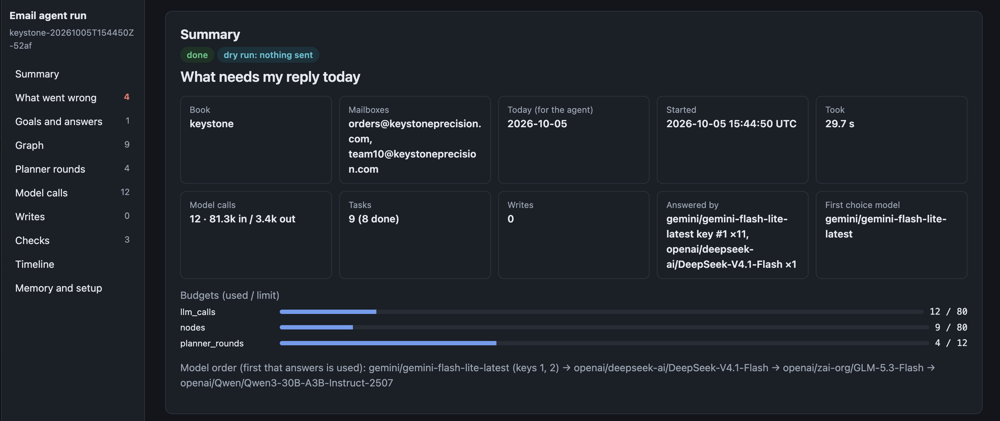
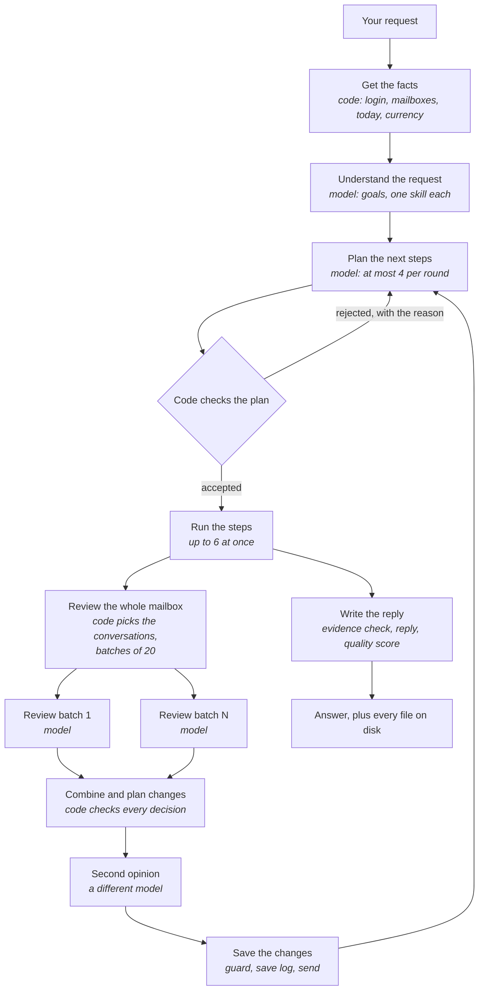

# An email agent for AgentSwitch: Team 10, Email seat

An AI agent that works a company mailbox on the AgentSwitch platform. You ask in plain English, for example the
seat's request: *"What needs my reply today, and find the mail where they agreed the price."* The agent reads the
mail, decides what needs doing, changes the platform's data (flags, memories, stars), and says what it did and why.
It declines what it must not do, and says why.

The same code runs unchanged on both company books:

| Book | Company | Country, money, tax |
|---|---|---|
| **Suryodaya** | Suryodaya Precision Works | India, rupees, GST |
| **Keystone** | Keystone Precision Works LLC | United States, dollars, sales tax |



**In numbers:** about 11,400 lines of agent code and 1,300 lines of test suite, with no agent framework. There are 24
test-suite tasks, 12 of which must be refused, and 73 offline tests plus 4 load tests. We filed 25 bug reports against
the platform.

## Contents

1. [What it does, and what it declines](#1-what-it-does-and-what-it-declines)
2. [How a run works](#2-how-a-run-works)
3. [The steps of a run, in plain words](#3-the-steps-of-a-run-in-plain-words)
4. [The checks: who checks what, and when](#4-the-checks-who-checks-what-and-when)
5. [How it is tested](#5-how-it-is-tested)
6. [Platform bugs we found](#6-platform-bugs-we-found)
7. [Set up and run](#7-set-up-and-run)
8. [Known limits](#8-known-limits)
9. [Repository layout and further reading](#9-repository-layout-and-further-reading)

---

## 1. What it does, and what it declines

The agent splits a request into **goals** and gives each goal one **skill**. A skill is a plain-English file
(`email_agent/skills/<name>/SKILL.md`) that holds its rules and lists the tools it may use.

| Skill | Ask it | What it changes on the platform |
|---|---|---|
| Triage replies | "What needs my reply today?" | Flags each conversation that needs a reply, due today, and says why |
| Find price agreements | "Find the mail where they agreed the price." | Saves each agreed price as a memory on that customer, with the accepting message and figures checked by code, and stars the conversation |
| Summarise conversations | "Summarise each conversation." | Writes the summary field where it is missing or out of date |
| Follow-up reminders | "Remind me where I am waiting on a reply." | Creates a "remind me if they don't reply" reminder |
| Remember about a customer | "Remember that Acme wants every quote in USD." | Saves (or reads back) a memory linked to that customer |
| Sort the inbox | "Sort my inbox." | Sets each conversation's importance and category |

It **declines**, changes nothing, and records the reason as data when a request:
- needs another department's data, such as a salary (*out of seat*);
- is about a mailbox that is not ours (*not our mailbox*);
- asks for something this seat must not do, such as sending or deleting mail (*not permitted*);
- has no support in the mail, such as a price nobody agreed (*no evidence*, *unknown record*).

A request can mix both kinds. For example, "What needs my reply today, and what is our CFO's salary?" answers the
first part and declines the second in the same run.

---

## 2. How a run works

A run is a **graph of steps that grows while it runs**. A planner (an AI model) adds a few steps at a time. Code
checks them, runs them (in parallel where it can), and shows the planner the results. The planner then adds the next
steps. The run ends, decided by code and not by the model, when every goal has an answer or has been declined.

Every change is written to a journal (`run.sqlite`) first. That means a run can stop at any point and be resumed
without sending any change twice.




The planner never sees the individual batches. It gets one summary after the changes are saved, so the number of
planning calls does not grow with the size of the mailbox: typically 3 to 8 per run.

---

## 3. The steps of a run, in plain words

| Step (plain name) | Name in the code | What it does | Model? |
|---|---|---|---|
| **Get the facts** | `build_context` | Who we are, which mailboxes are ours, today's date, and the company's currency and date format | No |
| **Understand the request** | goals step, `prompts/goals.md` | Splits the request into goals and gives each one skill. Marks a goal for declining when no skill may do it | Yes |
| **Plan the next steps** | planner round, `prompts/planner.md` | Adds at most 4 steps for the open goals, after seeing what happened so far | Yes |
| **Review the whole mailbox** | `judge_threads` | Code picks the conversations that matter to the skill and splits them into batches of 20. For triage, those are conversations whose newest real message is theirs and unanswered | No |
| **Review a batch** | `judge_shard` | One model call decides each conversation in the batch: needs a reply? price agreed? | Yes |
| **Combine and plan changes** | `join_verdicts` | Code checks every decision and builds the exact list of changes. For a price, it checks total = quantity × unit price | No |
| **Second opinion** | `validate_verdicts` (the validator) | A different model decides again every conversation that would be changed. Changes where the two disagree are held for you | Yes, a second model |
| **Save the changes** | `apply_writes` | Sends the agreed changes through the guard (only our mailboxes), the save log (never sent twice) and the dry-run switch | No |
| **Look up one record** | platform tools (`EmailThread.get`, `Party.list` …), local reads (`mailbox_overview`, `price_overview`, `recall_memory`) | One read about a named record, or for the memory skill | No |
| **Save one change** | `remember_fact`, `EmailThread.update` | One change, through the same guard and save log | No |
| **Write the reply** | `answer`, `prompts/answer.md` | Writes the answer for one goal from the evidence, after the evidence check | Yes |
| **Decline** | `refuse` | Ends a goal with a reason and changes nothing | Only for "no evidence" / "unknown record" (the evidence check) |
| **Settle unconfirmed saves** | `reconcile` | After a crash, reads the live record to see whether an unconfirmed change really happened. Then it records it, sends it once, or leaves it alone if someone else changed the row | No |

---

## 4. The checks: who checks what, and when

Code checks everything that can be checked exactly: every plan, every decision's shape, every figure and date, and
every change against the guard. Three model checks cover what code cannot judge. Each one asks a different question,
about a different thing, at a different moment:

```
review batches ──► SECOND OPINION ──► save changes ──► EVIDENCE CHECK ──► write the reply ──► QUALITY SCORE
                   "is each                            "is there enough                     "does the reply say
                    decision right?"                    to answer?"                          only what the
                                                                                             evidence shows?"
```

| | Second opinion (validator) | Evidence check (critic) | Quality score (verifier) |
|---|---|---|---|
| **Looks at** | each decision about one conversation | all the evidence for one goal | the written reply |
| **When** | after the batches decide, **before saving** | **before the reply is written**, and before declining for "no evidence" | **after** the reply is written |
| **Model** | a **different** model, fresh context, read-only | the main model | the main model |
| **If it says no** | that conversation is **not changed**; the reply lists it under "Needs your check" | the reply is **not written yet**; the planner is told what is missing and adds work. After 2 tries it is overruled, so a run cannot loop | **nothing**; the score (0–100) and its issues are shown on the run page |
| **Protects against** | a wrong change to shared data | a confident answer, or a decline, with no proof | (a measuring stick for later work) |
| **Example** | the judge says "needs a reply" for "Thanks, payment received"; the second model says no → no flag, and you are asked | the price goal is about to say "no agreement", but no search was made → "missing: search the mail" | the reply says "3 need a reply" where the evidence shows 4 → score 70, issue "count does not match" |

**Why this design.** One model can flip on borderline mail: on Keystone, 9 of 15 price decisions changed between
runs. Two independent models agreeing is the cheapest guard before a write to data other teams share. The evidence
check comes from the course's S17 design and stops the classic failure, an invented answer. The quality score is
kept as a record of answer quality across runs. It never holds anything back.

**On official runs the second opinion is skipped.** The AgentSwitch runner gives the agent one model, and the check
needs two, so the run records "no second model configured". The code checks still apply.

---

## 5. How it is tested

**Our test suite** ([`eval_harness/`](eval_harness)) runs the real agent against the live books. Each run is
**written to disk before anything is scored**. The checks then read the **platform's database**, never the agent's
words:

| Check | Approves when |
|---|---|
| `needs_reply_flagged` | exactly the conversations the answer key marks "needs a reply" are flagged, due today or earlier |
| `price_agreements_recorded` | each agreement in the key is saved as a memory naming the right accepting message, reference and figures; its conversation is starred; nothing else is recorded |
| `summaries_written` | every conversation has a current summary of 20–400 characters; no other field was written |
| `memory_recorded` | a memory with the right category and words is linked to the named customer |
| `refused_without_writes` | the goal was declined for an accepted reason, and the database shows nothing written |

The test suite has 24 tasks, 12 per book: the seat request (whole and in parts), summaries, memory, 6 refusals, and
a mixed request that is half answered and half declined. Task by task, with where each right answer comes from:
[docs/testing.md](docs/testing.md#2-the-12-tasks-per-book-and-where-each-right-answer-comes-from). **Answer keys are decided by a person**
(`eval_harness/ground_truth/`). A task whose key is undecided scores *unevaluated*, and *unevaluated* is never a
pass.

```bash
uv run eval-run --instance suryodaya      # runs the tasks; saves eval_runs/<batch>/
uv run eval-score eval_runs/<batch>       # verdicts, report.md and a web page
```

**The official run.** AgentSwitch runs the same suite on its own server against a fresh copy of each book, with its
own model and our seat's token. [`agentswitch-harness.toml`](agentswitch-harness.toml) tells it how:
`python -m eval_harness.official --ready-only --only …`. That command checks the platform and the model, runs two tasks
per book (the seat's whole request and one refusal), and writes `results.json` after every task. One token budget
covers both books, so each book keeps to its share and reasoning is switched off. Each task has its own time cap, an
unexpected failure becomes a row rather than a crash, and secrets are kept out of the evidence. Details:
[docs/testing.md](docs/testing.md#6-the-official-run).

**Offline tests** ([`tests/`](tests), 73 tests, about 11 seconds, no network or keys). Each test runs the real agent
against a fake AgentSwitch and a scripted model. They cover:
- crashes and resume (no change ever sent twice);
- write safety;
- the seat's requests;
- model trouble;
- large inboxes;
- memory;
- the watcher;
- concurrency;
- the official run.

A load test runs a 50,000-message mailbox (`uv run pytest -m scale -s`). The scenarios were chosen by Team 10; the
test code was written with Claude, as the first line of each file says. File by file:
[docs/testing.md](docs/testing.md).

---

## 6. Platform bugs we found

We filed **25 bug reports** against AgentSwitch, and found one more on 23 Oct (BUG-031). Where the agent has to live
with a bug, the code says so with a `WORKAROUND(BUG-…)` tag. The main ones:

| Bug | What happens | How the agent copes |
|---|---|---|
| BUG-001, BUG-008 | the same field arrives in different shapes (text, list, list of objects; 0/1 for booleans) | one lenient parser at the boundary |
| BUG-005 | a conversation's "last sender" and counts are not updated when messages arrive | facts are worked out from the messages themselves |
| BUG-014 | the platform's memory search never matches | our own full-text search over a local copy |
| BUG-019, BUG-026 | listings include other teams' mailboxes | rows from mailboxes that are not ours are dropped before the model sees them |
| BUG-022 | the sample mail repeats each message word for word from the other side | the copies are marked and never count as replies |
| BUG-031 | since Release 13, list tools break their own output schema, so the MCP SDK refuses the reply | the reply is read with our own contracts instead |

Every report, workaround and limit: [docs/known-issues.md](docs/known-issues.md).

---

## 7. Set up and run

You need Python 3.11 or newer and [uv](https://docs.astral.sh/uv/).

```bash
uv sync
cp .env.example .env        # then fill in the book passwords and at least one AI key (Gemini, W&B or OpenAI-compatible)
uv run pytest               # no keys needed
```

Start with `--dry-run`. It does everything except change platform data:

```bash
uv run email-agent "What needs my reply today, and find the mail where they agreed the price." --instance suryodaya --dry-run
uv run email-agent "Sort my inbox." --instance keystone --approve-writes   # stops before any change, for your yes
uv run email-agent --resume runs/<run_id> --approve                        # (or --reject: nothing is written)
uv run email-agent --resume runs/<run_id>                                  # continue a run that crashed or stopped
uv run email-view runs/<run_id> --open                                     # the run page
uv run email-watch --instance suryodaya                                    # the inbox watcher (dry by default)
```

Every run leaves a folder, `runs/<run_id>/`, written even after a crash. It holds:
- `report.md`: the run in plain words;
- `view.html`: the run page, with the graph, every model call, every write and the checks;
- `writes.jsonl`: every change, with its value before;
- `run.sqlite`: the journal that `--resume` reads;
- `spans.jsonl`: an OpenTelemetry trace.

The main settings (in `.env`):

| Setting | What it does |
|---|---|
| `PROVIDER`, `GEMINI_API_KEY` … `_5`, `WANDB_API_KEY`, `WANDB_MODELS` | which models answer, in order; one fails over to the next |
| `OPENAI_BASE_URL`, `OPENAI_API_KEY`, `OPENAI_MODEL` | any OpenAI-compatible model (the official run uses this) |
| `AGENTSWITCH_BASE_URL`, `AGENTSWITCH_TOKEN`, `AGENTSWITCH_INSTANCE` | set by the AgentSwitch runner: the book's address and the seat token |
| `VALIDATE_VERDICTS` | the second opinion (on) |
| `MAX_PLANNER_ROUNDS`, `MAX_LLM_CALLS`, `MAX_NODES` | per-run budgets (12, 80, 80) |
| `SEARCH` | `fts` (full text, the default) or `hybrid` (adds search by meaning) |
| `WANDB_THINKING` | `false` (the default): W&B models answer without reasoning first, for speed |

---

## 8. Known limits

- **On official runs, the second opinion is skipped**, because the runner provides one model (section 4).
- **Official runs check only two tasks per book**, so both books fit the run's one token budget; the other
  tasks run locally.
- **A price agreement must be quantity × unit price.** A lump-sum fee cannot be recorded yet.
- **Code picks the price candidates with word and amount rules** (quote, price, order, fee, invoice, any money
  amount). Mail about prices that uses none of them is not reviewed.
- **Search by meaning is built but off by default.** The first embedding of a very large mailbox takes hours.
- **An MCP session keeps the token it opened with.** REST logs in again when a token expires.
- **Not built:** drafting replies, sending mail (declined on purpose), meetings from mail (the seat has no calendar
  access).

More: [docs/known-issues.md](docs/known-issues.md).

---

## 9. Repository layout and further reading

```
email_agent/        the agent
  agent.py            one run, start to finish; resume
  graph/              planner, executor, journal, save log (outbox), reconcile, capabilities, workers, flows
  platform/           MCP and REST clients, tool calls, the write path, the run's context
  llm/                the model route (failover across keys and providers)
  mailbox/            the local mailbox copy: store, sync, conversation facts, search
  memory/             customer memory, earlier runs, the verdict cache
  watch/              the inbox watcher
  record/             what a run leaves behind: run log, report, run page, traces
  contracts/          every pydantic model, by area
  prompts/, skills/   the model prompts, and one SKILL.md per skill
eval_harness/       our test suite: tasks, answer keys, checks that read the database, the official run
tests/              the offline tests and their kit (fake platform, scripted model)
data/, watch/       the platform files the tests read; the watcher's rules
agentswitch-harness.toml   what the AgentSwitch runner installs and runs
```

| Document | What it covers |
|---|---|
| [docs/architecture.md](docs/architecture.md) | how the agent works, in plain words: every feature, how the graph organises a run, what each part does, the checks, safety and resume |
| [docs/testing.md](docs/testing.md) | how it is tested: each of the 12 tasks per book and where its right answer comes from, the refusals, the answer keys, the official run, the offline tests |
| [docs/known-issues.md](docs/known-issues.md) | platform bugs and workarounds, our own bugs found and fixed, limits |
| [docs/gap-report.md](docs/gap-report.md) | AgentSwitch's email app compared with AI email products |
