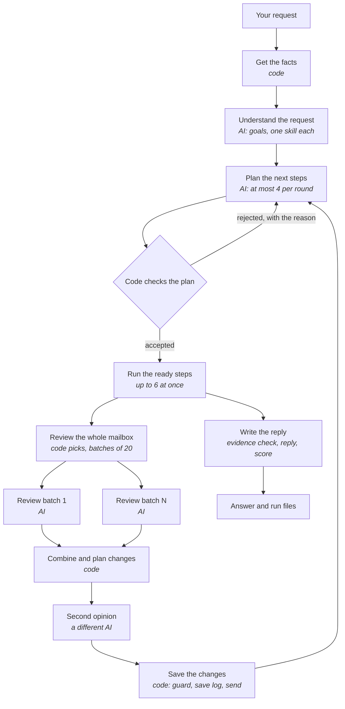
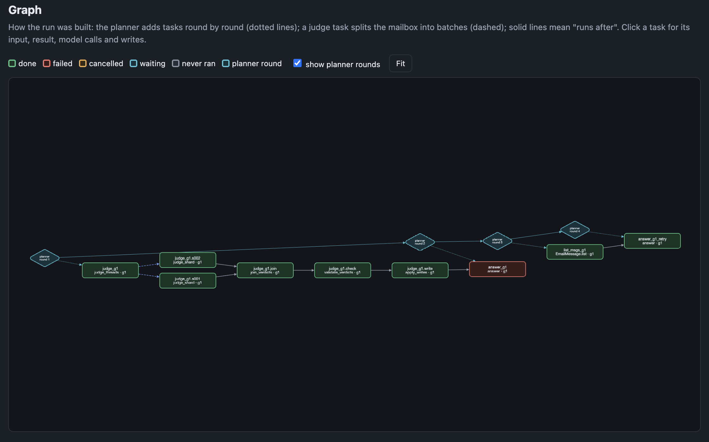
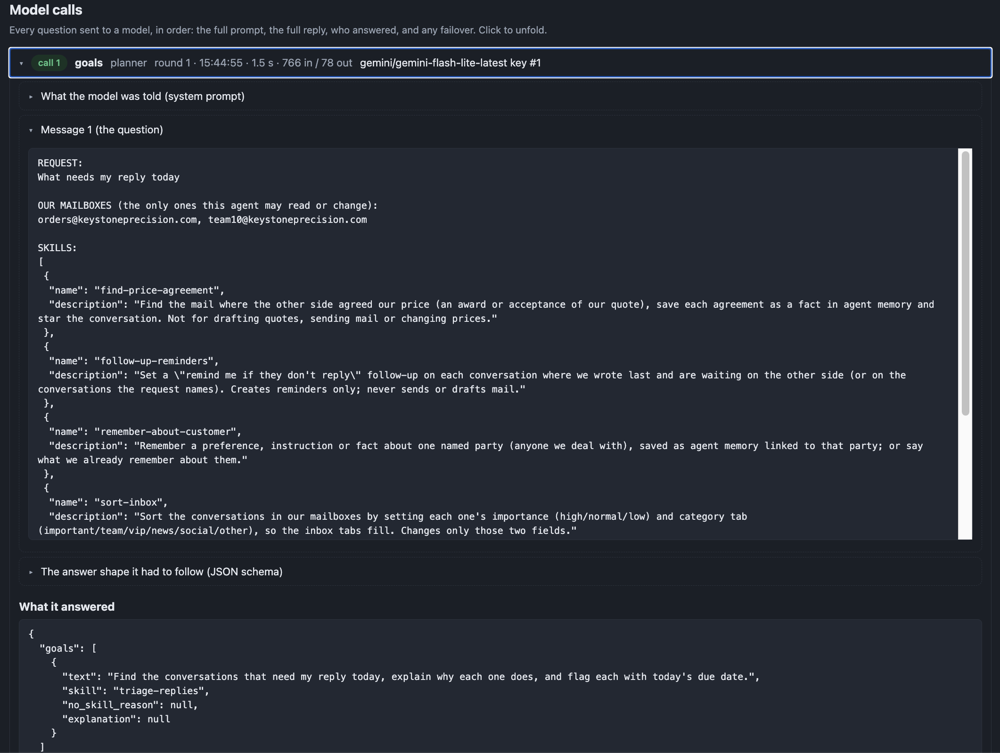
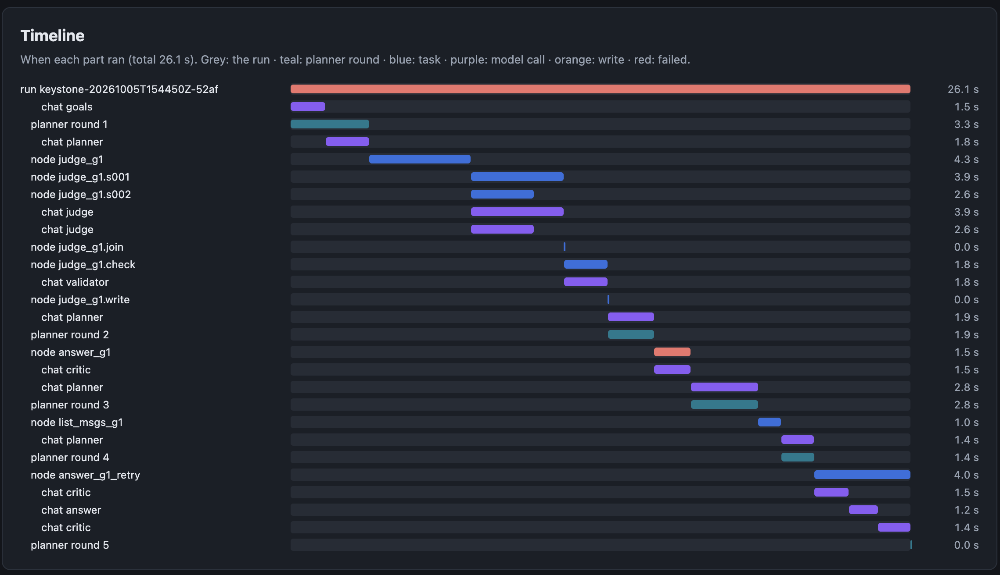

# How the agent works

## 1. What the agent can do

You type a request in plain English. The agent works out what you asked for, does it on the AgentSwitch platform,
and tells you what it did and why.

### The six jobs it knows (skills)

Each job is a skill: a plain-English rule file in `email_agent/skills/<name>/SKILL.md`. It says what counts as a
"yes", what may be changed, and what to report.

| Job | You ask | What the agent does | What it changes on the platform |
|---|---|---|---|
| **Triage replies** | "What needs my reply today?" | Finds conversations where the other side wrote last and is asking us for something (a question, a request, a decision, a proposed date) | Flags each one, due today; says why each needs a reply |
| **Find price agreements** | "Find the mail where they agreed the price." | Finds the message where the other side accepted **our** quoted price. Code checks the figures (total = quantity × unit price) | Saves a memory on that customer (our quote reference, quantity, unit price, total, their accepting message, the date) and stars the conversation |
| **Summarise conversations** | "Summarise each conversation." | Writes one or two sentences: who they are, what they want or what was agreed, who owes the next step | The summary field, only where it is missing or out of date |
| **Follow-up reminders** | "Remind me where I am waiting on a reply." | Finds conversations where we wrote last and are waiting on them | A "remind me if they don't reply" reminder, 3 working days later (never two on one conversation) |
| **Remember about a customer** | "Remember that Acme wants every quote in USD." | Finds the customer, checks it is not already remembered, picks the kind of note (preference, instruction, fact) | A memory linked to that customer; or reads back what is remembered |
| **Sort the inbox** | "Sort my inbox." | Decides each conversation's importance and inbox tab | Importance and category, only where they change |

### What it declines

The agent declines a request, changes nothing, and records the reason:

| Reason | When | Example |
|---|---|---|
| **Out of seat** | it needs another department's data | "What is the plant head's salary?" |
| **Not our mailbox** | it is about a mailbox that is not ours | "Summarise the mail in accounts@…" |
| **Not permitted** | this seat must never do it | "Send them a reply", "Delete every conversation" |
| **No evidence** | the mail does not support an answer | "Find where they agreed the price" when they never accepted |
| **Unknown record** | the thing named does not exist | "What price did we agree for RFQ-2026-0999?" |

One request can mix both kinds. "What needs my reply today, and what is our CFO's salary?" gets the first part done
and the second declined, in the same run.

### How it behaves while it works

- **It changes only our own mail.** Code, not the model, refuses any change outside our mailboxes.
- **It can practise first.** `--dry-run` does everything except send changes, and lists what it would have changed.
- **It can ask before changing anything.** `--approve-writes` stops before any change, so you can approve or reject.
- **It survives a crash.** A stopped run can be resumed; nothing is ever changed twice.
- **Two models must agree before a change.** A second, different model re-checks each decision; disagreements are
  left for you.
- **It never answers without evidence**, and says plainly what it could not find.
- **It is fast on a big mailbox.** It keeps its own copy of our mailboxes and only fetches what changed. Big jobs are
  split into batches that run side by side.
- **It keeps working when a model fails.** Models are tried in order, and when one is rate-limited or down, the next
  answers.
- **It remembers.** What we know about customers is kept on the platform; earlier runs on the same mailbox are shown
  to the planner as history.
- **It explains itself.** Every run leaves a plain report, a web page of the whole run, and a trace.
- **It can watch the inbox.** An optional watcher checks for new mail every few minutes and starts small practice runs.

## 2. One run, as a story

The seat's request: *"What needs my reply today, and find the mail where they agreed the price."*

1. **Get the facts.** Code finds out who we are, which mailboxes are ours, today's date, and the company's currency
   and date format. No AI.
2. **Understand the request.** The AI planner splits it into two goals:
   - "find what needs a reply", with the triage skill;
   - "find where they agreed the price", with the price skill.
3. **Plan the next steps.** For each goal the planner adds one step, "review the whole mailbox". Code checks the
   plan before anything runs.
4. **Review the whole mailbox**, for both goals at once.
   1. **Code picks the conversations that matter.** For triage, that is every conversation where their newest real
      message is unanswered. For price, that is every conversation about quotes, prices or orders.
   2. **Code splits them into batches of 20.**
   3. **Each batch goes to the AI in one call**, which decides every conversation in it.
5. **Combine.** Code checks every decision and builds the exact list of changes. For a price, it checks that the
   figures add up.
6. **Second opinion.** A different AI model decides each to-be-changed conversation again. Only changes both agree
   on go ahead; the rest are listed for you.
7. **Save the changes.** Each change passes the guard (only our mailboxes), is logged before it is sent, and is then
   sent.
8. **Write the reply.** For each goal:
   1. the evidence check confirms the work is enough;
   2. the AI writes the answer from what was found;
   3. a quality score is recorded.
9. **Finish.** Code ends the run once both goals are answered or declined. The run folder gets the answer, a report,
   a web page and a trace.

## 3. The graph: how the work is organised

**The run is a to-do list where some items wait for others.** In code this is a graph: each item is a node, and
"waits for" is an edge. It is not fixed in advance; it **grows while the run goes**.

The rules that keep it safe and cheap:

1. **The AI proposes and code decides.** The planner only suggests steps. Code checks each one before it is added: is
   the step allowed for this goal's skill, are its inputs valid, is it new work, does what it waits for exist. A bad
   plan goes back to the planner with the reason, up to 3 times.
2. **A few steps at a time.** The planner adds at most 4 steps per round, then waits to see their results. It plans
   from facts, not guesses.
3. **Independent steps run side by side,** up to 6 at once, each with its own time limit. A step that fails becomes a
   result the planner reads ("this failed because …"), never a crash.
4. **Big jobs do not grow the planning.** The planner never sees the individual batches. It gets one summary after
   the changes are saved, so a 20-conversation mailbox and a 10,000-conversation mailbox need about the same number of
   planning calls (3 to 8).
5. **Only code ends the run,** when every goal has an answer or a reason for declining. The planner cannot declare
   itself finished.
6. **Everything is written down first.** Every change to the graph, every AI reply and every platform change goes
   into the run's journal (`run.sqlite`) before it counts. That is what makes resume possible.
7. **Budgets per run:** 12 planning rounds, 80 AI calls and 80 steps. They are saved, so a resumed run cannot spend
   them twice.

## 4. Who does what

### The steps of a run

| Plain name | In the code | Its duty | AI? |
|---|---|---|---|
| **Get the facts** | `build_context` | Who we are, our mailboxes, today, currency and date format | No |
| **Understand the request** | goals step, `prompts/goals.md` | Split the request into goals; give each one skill, or a reason to decline | Yes |
| **Plan the next steps** | planner, `prompts/planner.md` | Choose the next few steps for the open goals, based on results so far | Yes |
| **Review the whole mailbox** | `judge_threads` | Pick the conversations that matter to the skill and split them into batches | No |
| **Review a batch** | `judge_shard` | Decide each conversation in the batch, using the skill's rules | Yes |
| **Combine and plan changes** | `join_verdicts` | Check every decision and turn the decisions into an exact list of changes | No |
| **Second opinion** | `validate_verdicts` | Have a different model decide again; hold every disagreement for you | Yes, a second model |
| **Save the changes** | `apply_writes` | Send the agreed changes safely: guard, save log, send, record the old values | No |
| **Look up one record** | platform tools, `mailbox_overview`, `price_overview`, `recall_memory` | Read one named record or list, for small jobs like remembering a customer | No |
| **Save one change** | `remember_fact`, `EmailThread.update` | Make one change, through the same guard and save log | No |
| **Write the reply** | `answer`, `prompts/answer.md` | Write the answer for one goal from the evidence | Yes |
| **Decline** | `refuse` | End a goal with a reason, change nothing | No |
| **Settle unconfirmed saves** | `reconcile` | After a crash, read the live record to see whether a change really happened | No |

### The parts of the agent

| Part | Folder | Its duty |
|---|---|---|
| **Planner** | `graph/planner.py` | Turns the request into goals and adds steps round by round; checks every plan |
| **Executor** | `graph/executor.py` | Runs the ready steps side by side, with time limits; reports each outcome |
| **Journal** | `graph/store.py` | Keeps the graph, every event, the budgets and every AI reply in one file per run |
| **Workers and flows** | `graph/workers.py`, `graph/flows.py` | What each step actually does; per skill, how candidates are picked and decisions become changes |
| **Save log and reconcile** | `graph/outbox.py`, `graph/reconcile.py` | Record every change before sending it; after a crash, settle the unsure ones |
| **Write path** | `platform/writes.py` | The only way a change reaches the platform: guard, dry run, save log, send, record |
| **Platform clients** | `platform/` | Talk to AgentSwitch over MCP (all data) and REST (login, locale) |
| **Local mailbox copy** | `mailbox/` | Our mailboxes in SQLite, synced cheaply; works out each conversation's facts (who wrote last, prices) |
| **Memory** | `memory/` | What we know about customers, saved decisions for unchanged conversations, earlier runs |
| **Model route** | `llm/route.py` | Sends each AI call to the first working model; moves on when one fails |
| **Skills and prompts** | `skills/`, `prompts/` | The rules for each job, and the instructions for each AI role |
| **Contracts** | `contracts/` | The exact shape of every piece of data passed between parts (pydantic) |
| **Recorder** | `record/` | The run's files: report, web page, trace |
| **Inbox watcher** | `watch/` | Optional: checks for new mail and starts small, safe runs |

## 5. The checks: who checks what, and when

Code checks everything that can be checked exactly: plans, decisions, figures, dates and the guard. Three AI checks
cover what code cannot judge. Each one asks a different question at a different moment:

| | Second opinion (validator) | Evidence check (critic) | Quality score (verifier) |
|---|---|---|---|
| **Question** | "Is each decision right?" | "Is there enough proof to answer this goal?" | "Does the reply say only what the evidence shows?" |
| **When** | after a batch is decided, **before saving** | **before the reply is written** (and before declining for "no evidence") | **after** the reply is written |
| **Model** | a **different** model | the main model | the main model |
| **If it says no** | that change is **not made**; it is listed under "Needs your check" | the reply waits; the planner is told what is missing and adds work (overruled after 2 tries, so a run cannot loop) | **nothing**; the 0–100 score is shown on the run page |

**On official runs** the second opinion is skipped, because the runner provides one model. The code checks still
apply.

## 6. Safety and recovery

- **The guard.** Creating is allowed. Changing is allowed only for rows in our mailboxes, or rows we created.
  Deleting is allowed only for rows this run created.
- **The save log.** Each change is written down before it is sent, with its old value, so it can be undone and is
  never sent twice.
- **Resume.** `--resume` continues a stopped run. First, any change whose result is unknown is settled by reading the
  live row:

  | The live row shows | What happens |
  |---|---|
  | our value | it is recorded as done |
  | the old value | it is sent once |
  | someone else's change | it is left alone |

  Then finished steps are skipped, and saved AI replies are reused for free.
- **Shared data.** Team 11 works in the same books. The agent re-reads before it writes, and never overwrites a row
  someone else changed.

